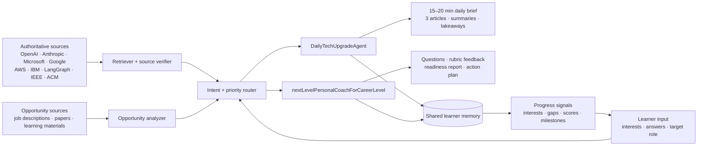

# Build Your Personal Agentic AI Coworkers

**Student project:** San José State University

**Prototype:** DailyTechUpgradeAgent + nextLevelPersonalCoachForCareerLevel

**Prototype files:** [`agentic_workers.py`](./agentic_workers.py) and [`index.html`](./index.html)

The Python runner is the actual agentic prototype. The HTML dashboard is the presentation/demo surface for the same assignment concepts.

## 1. Agent goals

### Agent 1 — DailyTechUpgradeAgent

**Purpose:** Help a technical learner improve every day through a focused, trustworthy reading habit.

**Expected outcomes:**

- Identify three high-quality technical articles or blogs from authoritative sources.
- Summarize the most useful technical ideas in plain language.
- Connect each idea to the learner’s current interests and target role.
- Fit the experience into a 15–20 minute daily session.
- Convert reading into an action: a question, note, or small applied exercise.

**Personalization profile used in the prototype:** AI agents, evaluation, Python/API systems, and preparation for an AI/ML engineering internship. The active knowledge gap is observability.

### Agent 2 — nextLevelPersonalCoachForCareerLevel

**Purpose:** Turn a learner’s target opportunity into a measurable preparation loop.

**Expected outcomes:**

- Identify technical strengths and gaps against a target role.
- Ask technical questions and coding/system-design exercises.
- Evaluate answers against a rubric and give specific feedback.
- Recommend resources and a time-bounded preparation plan.
- Track progress toward an internship, job, research role, or startup milestone.

**Target opportunity used in the prototype:** AI/ML Engineer Intern, with emphasis on agent systems, Python, APIs, evaluation, and clear technical communication.

## 2. Architecture diagram



### Component responsibilities

| Component | Responsibility | Prototype behavior |
|---|---|---|
| Source retriever | Collect candidate technical content | Live RSS attempts for AWS, LangChain, and Google Cloud, with verified authoritative fallback records |
| Source verifier | Check authority, date, relevance, and URL presence | Evaluation rubric shown in the Evaluation tab |
| Opportunity analyzer | Extract skills and evidence from target opportunities | Internship/job, SJSU career, research, and entrepreneurship opportunity records |
| Intent router | Select the appropriate coworker workflow | Two specialized tabs with shared profile |
| DailyTechUpgradeAgent | Rank, summarize, and connect reading to goals | Three-item daily brief |
| Career Coach | Ask, score, explain, and plan | Interactive system-design challenge |
| Shared memory | Preserve learner preferences, gaps, and progress | Interests, active gap, next milestone panel |

## 3. Working prototype

Run the actual agents from the project directory:

```bash
python3 agentic_workers.py demo
```

The runner is dependency-free and works offline with a verified local source catalog. It creates `.agent_memory.json` and persists shared learner memory across runs. It exposes individual tools and workflows through:

```bash
python3 agentic_workers.py daily
python3 agentic_workers.py coach --answer "I would create a proposed state, await approval, execute with permission checks, persist a trace, and retry transient failures."
python3 agentic_workers.py coach --interactive
python3 agentic_workers.py memory
```

Open [`index.html`](./index.html) in a browser for the visual demonstration.

### Demonstrated interactions

1. **DailyTechUpgradeAgent tab**
   - Shows three technical recommendations.
   - Displays source, reading time, publication date, URL, summary, and technical takeaway.
   - Explains why the recommendations fit the learner’s goal.
   - Includes a refresh interaction and learning log.

2. **Career Coach tab**
   - Shows target role and current readiness score.
   - Presents an interactive state-machine/system-design question.
   - Grades a short response using a simple rubric.
   - Identifies strengths, gaps, and entrepreneurial opportunities.
   - Produces a seven-day preparation plan.

3. **Architecture tab**
   - Shows the end-to-end workflow, tools, data sources, and shared memory.

4. **Evaluation tab**
   - Shows quality, learning-transfer, and career-readiness metrics.
   - Includes a concrete prototype test plan.

5. **Interactive terminal coaching**
   - `--interactive` asks a system-design question and a safety/observability follow-up.
   - Both answers are scored and saved to shared memory.

### Why this is agentic

The agents are not only static responses. Each worker:

- observes structured learner context from shared memory;
- chooses and calls tools;
- transitions through explicit workflow states;
- produces structured output;
- reflects against a time/goal constraint or rubric;
- updates persistent memory for the next run.

The daily worker traces `RETRIEVE → RANK → SUMMARIZE → REFLECT → DONE`. The career worker traces `ANALYZE_OPPORTUNITY → PLAN_CHALLENGE → ASSESS → MEMORIZE → DONE`.

### Sample daily technical brief

| Article | Source/date | Technical insight | Career connection |
|---|---|---|---|
| Building reliable agents with tool-use boundaries | OpenAI Documentation · Oct. 24, 2026 | Tools should have typed inputs, permissions, traces, and recovery paths. | Useful for production-agent system design interviews. |
| Stateful orchestration for human-in-the-loop systems | LangGraph · Oct. 23, 2026 | Durable state allows an agent to pause for approval and resume safely. | Builds practical workflow/orchestration fluency. |
| Evaluating generative AI beyond “it sounds right” | IEEE Standards · Oct. 21, 2026 | Groundedness, task success, calibration, and user progress should be measured. | Directly addresses the learner’s observability/evaluation gap. |

## 4. Sample interactive coaching session

**Coach prompt:**

> You need to let an agent call a web search tool, but a user must approve any external side effect. Describe the state transitions you would model.

**Strong answer should include:**

- `Ready` or `Planning`
- `ToolProposed`
- `AwaitingApproval`
- `Executing`
- `Succeeded` or `Failed`
- retry/abort behavior
- persistence of the proposed action and traceability

**Prototype feedback:**

> You identified the core approval boundary. To level up, name an explicit `AwaitingApproval` state, persist the proposed action, and define a retry path for tool failure. That detail shows production judgment.

**Resulting action:** Build a small trace viewer that records agent input, tool call, approval event, latency, error state, and final outcome.

## 5. Evaluation plan

### Effectiveness

- Daily brief completion rate: target at least 5 of 7 days.
- Article usefulness rating: target average of 4/5 or higher.
- Weekly applied artifact: target one small coding/design artifact per week.
- Career readiness score: measure movement across technical depth, communication, evidence of work, and interview performance.

### Accuracy and trust

- Verify every URL resolves to the intended source.
- Verify title, publication date, and author/source metadata.
- Use a human rubric for summary faithfulness and technical correctness.
- Target at least 90% citation correctness and 80% human/agent coaching-rubric agreement.

### Learning progress

- Compare a baseline answer with a post-reading answer on a novel prompt.
- Track concept recall and ability to apply an idea outside the original article.
- Track surfaced gaps and whether the learner completes the recommended practice.

### Prototype test plan

1. Run the daily brief for 10 days and rate relevance, freshness, and actionability.
2. Submit 10 technical answers and compare agent scores with a human rubric.
3. Complete one unseen system-design prompt at the end of the week.
4. Review whether the readiness report changed based on evidence rather than conversation length.

## 6. Production extension path

The prototype is executable and dependency-free. A larger deployment could add:

- LangGraph stateful workflows for the router, retriever, summarizer, coach, and evaluator.
- Additional RSS/API connectors for OpenAI, Anthropic, Microsoft, IBM, IEEE, ACM, and other approved sources.
- Structured output schemas for article metadata, opportunity skills, rubric scores, and progress events.
- Embeddings-backed memory for learner preferences and prior concepts, with inspect/edit/delete controls.
- A scheduled daily run that writes a brief to a dashboard or email.
- Human approval before external side effects and observability for every tool call.

## 7. Limitations and responsible-use notes

- The daily agent attempts live RSS retrieval and falls back to verified authoritative records if a feed is unavailable.
- Readiness percentages are prototype signals, not hiring predictions.
- The coach should expose its rubric and allow the learner to correct inaccurate memory.
- Personal data should be minimized and stored securely; raw sensitive information should not be retained by default.
